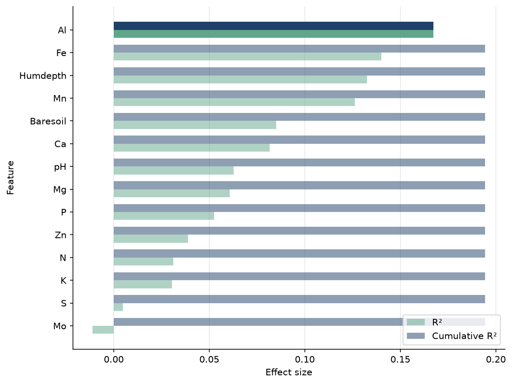

# PyRDA: Python Distance-Based Redundancy Analysis

A Python port of [RLdbRDA](https://github.com/raeslab/rldbrda), the RaesLab's R package
for Distance-Based Redundancy Analysis (db-RDA). This package provides a streamlined
workflow for conducting db-RDA analysis on microbial datasets to identify and visualize
the impact of metadata variables on community composition.

## Features

- **Same results as RLdbRDA**: R², adjusted R², F, AIC and the forward selection match
  `vegan::capscale`/`anova.cca`/`ordiR2step` to ~1e-14; with `test="permutation"` and the
  same seed the p-values are identical to R's (see the
  [validation report](docs/comparison.md))
- **All vegan distances**: every `vegan::vegdist` index (except `robust.aitchison`), same names
- **Statistical Testing**: by default a permutation-free analytic test that gives R's
  permutation p-values without permuting (fast and deterministic); R's permutation tests
  are available too. Benjamini-Hochberg correction as in R
- **Forward Selection**: Stepwise model building to identify non-redundant effects
- **Visualization**: Create publication-ready plots showing individual and cumulative effect sizes
- **Validation**: Comprehensive input validation and error checking

## Installation

### From GitHub

```bash
uv add git+https://github.com/raeslab/pyrda        # or: pip install git+https://github.com/raeslab/pyrda
```

### From Source

```bash
git clone https://github.com/raeslab/pyrda
cd pyrda
uv sync          # or: pip install -e .
```

### Dependencies

- Python ≥ 3.10
- numpy ≥ 1.20.0
- pandas ≥ 1.3.0
- scipy ≥ 1.7.0
- matplotlib ≥ 3.5.0

## Quick Start

### Example data

[`docs/data`](docs/data) holds the `varespec` and `varechem` data sets of the R package
[vegan](https://cran.r-project.org/package=vegan), exported unchanged as tab-separated
files:

- `varespec.tsv`: estimated cover of 44 plant species (columns) in 24 lichen pastures
  (rows)
- `varechem.tsv`: 14 soil characteristics of the same 24 sites, such as Al, pH, the
  thickness of the humus layer (`Humdepth`) and the cover of bare soil (`Baresoil`)

Source: Väre, H., Ohtonen, R. and Oksanen, J. (1995) Effects of reindeer grazing on
understorey vegetation in dry *Pinus sylvestris* forests. *Journal of Vegetation Science*
6, 523-530.

The data ship with the repository, not with the package: run the example from the
repository root.

### Example

```python
import pandas as pd
from pyrda import rldbrda, prepare_plot_data, plot_dbrda

species = pd.read_csv("docs/data/varespec.tsv", sep="\t", index_col=0)
soil = pd.read_csv("docs/data/varechem.tsv", sep="\t", index_col=0)

# db-RDA on Bray-Curtis distances (analytic p-values, no permutations)
results = rldbrda(species, soil, method="bray", p_cutoff=0.05)

# Exactly the same output as set.seed(1); RLdbRDA::rldbrda(...) in R
results_r = rldbrda(species, soil, test="permutation", seed=1)

# Effect-size plot
fig = plot_dbrda(prepare_plot_data(results))
fig.savefig("dbrda_plot.png", dpi=150, bbox_inches="tight")
```

[`docs/example.py`](docs/example.py) runs this analysis and writes the output below to
[`docs/output`](docs/output): `uv run python docs/example.py`.

### Example output

`results`, rounded and with the main columns only (full table:
[`docs/output/dbrda_results.tsv`](docs/output/dbrda_results.tsv)):

| | r2 | r2adj | pval | padj | RDAcumul_R2.adj |
|---|--:|--:|--:|--:|--:|
| **Al** | 0.203 | 0.167 | 0.001 | 0.007 | 0.167 |
| `<All variables>` | | | | | 0.194 |
| Fe | 0.177 | 0.140 | 0.001 | 0.007 | |
| Humdepth | 0.170 | 0.132 | 0.002 | 0.007 | |
| Mn | 0.164 | 0.126 | 0.002 | 0.007 | |
| Baresoil | 0.125 | 0.085 | 0.011 | 0.027 | |
| Ca | 0.122 | 0.082 | 0.012 | 0.027 | |
| pH | 0.103 | 0.063 | 0.024 | 0.047 | |
| Mg | 0.102 | 0.061 | 0.027 | 0.048 | |
| P | 0.094 | 0.052 | 0.046 | 0.071 | |
| Zn | 0.081 | 0.039 | 0.075 | 0.105 | |
| N | 0.073 | 0.031 | 0.113 | 0.136 | |
| K | 0.073 | 0.030 | 0.116 | 0.136 | |
| S | 0.048 | 0.005 | 0.335 | 0.361 | |
| Mo | 0.033 | -0.011 | 0.609 | 0.609 | |

Eight soil variables are significant on their own (`padj` < 0.05), aluminium (Al) being
the strongest: alone it explains 16.7% of the variation in community composition
(adjusted R²). These eight variables overlap, though: together they explain 19.4%
(`<All variables>`). Forward selection starts with Al, but the best next variable (Ca)
would raise the adjusted R² to 21.9%, above that of the full model, so selection stops
there. Al is the only non-redundant effect.



Green bars show each variable's adjusted R² on its own. Blue bars show the cumulative
adjusted R² of the forward selection. Variables that were not selected are faded, and
their blue bar shows the value of the model with all significant variables, as in
RLdbRDA.

## Usage

### Basic Analysis

The main function `rldbrda()` performs the complete analysis workflow:

```python
from pyrda import rldbrda

results = rldbrda(
    df=species_data,  # Species abundance matrix
    meta=environmental_data,  # Environmental metadata
    method="bray",  # Distance metric (vegan::vegdist name)
    p_cutoff=0.05,  # Significance threshold
    test="analytic",  # default; "permutation" runs R's permutation tests
    seed=None,  # with test="permutation": seed=1 reproduces set.seed(1) in R
)
```

### Parameters

- **df**: pandas.DataFrame with samples as rows and species as columns
- **meta**: pandas.DataFrame with samples as rows and environmental variables as columns
- **method**: any `vegan::vegdist` method ("bray", "jaccard", "euclidean", "hellinger",
  "gower", ...; scipy's "braycurtis" is accepted too). Other names go to
  `scipy.spatial.distance.pdist` and have no R equivalent.
- **p_cutoff**: variables with `padj < p_cutoff` enter the forward selection (default:
  0.05)
- **test**: how p-values are computed
  - `"analytic"` (default): no permutations. Uses the exact mean, variance and skewness
    of the permutation distribution (Pearson type III approximation); p-values agree with
    R's permutation test within its own Monte Carlo error and are deterministic. When a
    test's permutation distribution is strongly skewed (a few samples dominate the
    variation, e.g. Euclidean distance on raw counts) the approximation can be off; a
    warning then names the affected variables so you can check them with
    `test="permutation"`
  - `"permutation"`: vegan's permutation tests, 999 permutations per variable and 9999
    per forward-selection step, exactly as RLdbRDA
- **permutations** / **cumul_permutations**: number of permutations (default 999 / 9999);
  the analytic test reports its p-values on the same scale (smallest value 1/1000)
- **seed**: seed of the R-compatible random generator used by `test="permutation"`;
  `seed=s` gives the same permutations as `set.seed(s)` in R

### Results

`rldbrda()` returns a DataFrame indexed by variable name: one row per metadata variable
plus an `<All variables>` row.

| Column | Meaning |
|---|---|
| `feature` | Variable name (empty for `<All variables>`) |
| `Fa` | Pseudo-F of the variable on its own |
| `r2`, `r2adj` | R² and adjusted R² of the variable on its own |
| `N` | Number of samples |
| `pval` | p-value of the pseudo-F test (analytic or permutation) |
| `padj` | Benjamini-Hochberg adjusted p-value |
| `RDAcumul_R2.adj` | Adjusted R² of the forward-selection model after adding this variable. For `<All variables>`: the adjusted R² of the model with all significant variables, the upper limit of the selection |
| `RDAcumul_Df` | Degrees of freedom the variable adds: 1 for a numeric or logical variable, k − 1 for a factor with k levels |
| `RDAcumul_AIC` | AIC of the model after adding the variable |
| `RDAcumul_F`, `RDAcumul_pval` | Pseudo-F and p-value of the variable added to the variables selected before it (using `cumul_permutations`). They are reported only: the selection itself is decided by adjusted R² |
| `RDAcumul_N` | Number of samples |

The `RDAcumul_*` columns are empty (NaN) for variables that were not selected: either
they were not significant, or they were redundant with the variables selected before them.
The rows are ordered as in RLdbRDA: the selected variables in the order they were
selected, then `<All variables>`, then the other variables by decreasing `r2`.

### Visualization

```python
from pyrda import prepare_plot_data, plot_dbrda

# Prepare data for plotting
plot_data = prepare_plot_data(results)

# Create horizontal bar plot
fig = plot_dbrda(plot_data, figsize=(10, 8))

# Customize colors if desired
fig = plot_dbrda(
    plot_data,
    colors={
        "r2adj": "#60A68B",  # Individual R²
        "RDAcumul_R2.adj": "#1F4068",  # Cumulative R²
    },
)
```

`prepare_plot_data()` returns the long-format table RLdbRDA plots: columns `feature`,
`variable` (`r2adj` or `RDAcumul_R2.adj`), `value` and `significant` (1 for selected
variables, 0 for the others, which are drawn faded). For variables that were not
selected, the cumulative value is that of `<All variables>`.

`pyrda.plotting.create_summary_plot(results, save_path="dbrda.png", show_plot=False)`
does both steps and saves the figure.

### Other functions

The steps of `rldbrda()` are available on their own:

- `vegdist(x, method="bray", binary=False)`: square distance matrix (numpy array), as
  `vegan::vegdist`; `binary=True` converts the data to presence/absence first.
- `get_r2(distance_matrix, meta, test="analytic", permutations=999, seed=None)`: the
  individual effects only (`feature` to `padj`), for all columns of `meta`, without a
  significance filter or forward selection. Unlike `rldbrda()` it accepts missing values
  in `meta`: samples without a value are left out of that variable's test, which `N`
  shows. `get_r2_single()` does the same for one variable.
- `get_cumulative(distance_matrix, meta, test="analytic", permutations=9999, seed=None)`:
  forward selection on all columns of `meta` (no missing values), returning the
  `RDAcumul_*` columns.

`distance_matrix` can be any square distance matrix with rows in the order of `meta`, for
instance one computed elsewhere (such as vegan's `robust.aitchison`). `seed` takes an
integer or an `RRandom` object, R's random number generator; passing the same `RRandom`
to several calls continues one random stream, as `rldbrda()` does.

## Data Requirements

### Input Data Format

1. **Species/Community Data** (`df`): rows = samples, columns = species/taxa; numbers
   only, no missing values. The data are used as they are: normalise, rarefy or transform
   them yourself if your analysis needs it.
2. **Environmental Metadata** (`meta`): rows = samples, columns = environmental variables

### Requirements

`rldbrda()` checks these and raises a `ValueError` when one is not met:

- Both tables have the same row index, in the same order. Align them with
  `meta = meta.loc[df.index]`.
- No missing values, neither in `df` nor in `meta`. Drop or impute samples first (or use
  `get_r2()`, which leaves samples out per variable).
- Column names of `meta` are valid Python identifiers (see below). They must also be
  unique.
- At least one variable has `padj < p_cutoff`, otherwise there is nothing to select:
  `rldbrda()` stops with `No significant features found, cannot continue!`. Use `get_r2()`
  to get the individual effects anyway.

### Metadata types

- **Numeric** columns are continuous variables (one degree of freedom).
- **Logical** columns (`True`/`False`) count as 0/1 (one degree of freedom).
- **Text and categorical** columns (anything not numeric or logical) are factors, coded as
  in R with one dummy column per level except the first (k − 1 degrees of freedom). The
  choice of reference level does not change R² or p-values. Numbers stored as text are
  factors too, with one level per distinct value: convert them with `pd.to_numeric` first.
- A **constant** column cannot explain anything: it gets R² = 0 and no p-value, with a
  warning (RLdbRDA stops with an error).

### Column names

`make_valid_names()` turns column names into valid Python identifiers: characters other
than letters and digits become `_`, names starting with a digit get an `X` in front, and
empty names become `X`.

```python
from pyrda.validation import make_valid_names

meta.columns = make_valid_names(meta.columns)
assert meta.columns.is_unique  # "a-b" and "a.b" both become "a_b"
```

### Data Validation

`validate_input()` runs the checks on the row index, missing metadata and column names
without running the analysis:

```python
from pyrda.validation import validate_input

# This will raise informative errors if data doesn't meet requirements
validate_input(species_data, environmental_data)
```

### Warnings

pyrda warns, and continues, when:

- the analytic p-value of a variable may be inaccurate (see **test** above);
- a metadata variable has no variation (constant column);
- no variable improves the adjusted R², so the forward selection selects nothing (only the
  `<All variables>` row then has `RDAcumul_*` values);
- the distance is computed on data with empty rows (samples without any counts) or, for
  indices that need non-negative data, negative values.

## Methodology

PyRDA implements a two-step db-RDA procedure:

1. **Individual Effects**: Calculate R² for each environmental variable using constrained ordination
2. **Cumulative Effects**: Forward stepwise selection to identify non-redundant variable contributions

### Statistical Approach

- **Distance Matrix**: port of `vegan::vegdist`
- **Constrained Ordination**: as `vegan::capscale`: principal coordinates on all axes with
  positive eigenvalues, then redundancy analysis; negative eigenvalues are left out of R²
- **Significance Testing**: pseudo-F as `anova.cca`; p-values from the exact moments of the
  permutation distribution (default) or from the permutations themselves
- **Multiple Testing**: Benjamini-Hochberg false discovery rate correction
- **Forward Selection**: as `vegan::ordiR2step(Pin = 1, R2scope = TRUE)`: add the variable
  with the largest adjusted R² while it increases and stays at or below the adjusted R² of
  the model with all significant variables

## Comparison with R Implementation

PyRDA reproduces RLdbRDA. Statistics agree to ~1e-14. With `test="permutation", seed=s`
the p-values are identical to `set.seed(s); rldbrda(...)` in R; with the default analytic
test they agree within R's own run-to-run variation, and the selected variables match R's
most frequent result. The [validation report](docs/comparison.md) has the details: what
was compared, how close the results are, and how accurate and fast the analytic test is.

### Known differences

- **Ties in forward selection**: when adding a variable gives exactly the adjusted R² of
  the full model, R decides `R2 <= R2.all` by floating-point rounding, so its selection can
  change with the column order of `meta`. PyRDA treats equal values as equal and adds the
  variable.
- **Crash cases**: where R stops with an error (a constant metadata column, or no variable
  improving the model) PyRDA warns and continues.
- **Row order**: R sorts on R² as text, which misplaces variables with R² < 1e-4; PyRDA
  sorts numerically.
- **`robust.aitchison`** is not available (vegan imputes zeros with OptSpace).

## Development

The dev container, the tests and how to contribute are described in
[docs/dev.md](docs/dev.md).

## Support

- **Issues**: Report bugs and request features on [GitHub Issues](https://github.com/raeslab/pyrda/issues)
- **Documentation**: See docstrings in the source code
- **Examples**: [`docs/example.py`](docs/example.py) and its data and output in [`docs`](docs)

## Author and license

pyrda is written by Sebastian Proost and released under the
[GNU General Public License, version 2](LICENSE) (GPL-2.0-only).

**Why GPL-2.** Parts of pyrda are ports of code from the R packages
[vegan](https://cran.r-project.org/package=vegan) (the distance indices of `vegdist`, the
constrained ordination of `capscale` and the tests of `anova.cca` and `ordiR2step`) and
[permute](https://cran.r-project.org/package=permute) (`shuffleSet`). A port of GPL code
must be distributed under the same license. vegan and permute are licensed under GPL
version 2 *only*, not "version 2 or later", and GPL-3 cannot be combined with
GPL-2-only code, so GPL-2 is the most recent GPL version pyrda can use.

## Acknowledgments

This Python implementation is based on the original R package
[RLdbRDA](https://github.com/raeslab/rldbrda) developed by Sebastian Proost for the
RaesLab. The statistical methodology follows established practices in microbial ecology
and community analysis.

## References

The default analytic test (`test="analytic"`) computes p-values without permutations, using
the method of:

- Kazi-Aoual, F., Hitier, S., Sabatier, R. & Lebreton, J.-D. (1995). Refined
  approximations to permutation tests for multivariate inference. *Computational
  Statistics & Data Analysis*, 20(6), 643-656.
  [doi:10.1016/0167-9473(94)00064-2](https://doi.org/10.1016/0167-9473(94)00064-2)

Every pseudo-F test in the workflow is equivalent to a permutation test on
`tr(A P G P')`, with `G` the Gower matrix of the principal coordinates, `A` the projection
onto the constraints and `P` a permutation of the samples. Kazi-Aoual et al. give the exact
mean, variance and third moment of this statistic over all `n!` permutations; the p-value
is then read from a Pearson type III distribution with those three moments. pyrda derives
the same moments in a different, generic way (see `src/pyrda/moments.py`); they agree with
the published closed-form expressions to machine precision.

An open-access discussion of these approximations, including the Pearson type III
approximation, is given by:

- Josse, J., Pagès, J. & Husson, F. (2008). Testing the significance of the RV
  coefficient. *Computational Statistics & Data Analysis*, 53(1), 82-91.
  [doi:10.1016/j.csda.2008.06.012](https://doi.org/10.1016/j.csda.2008.06.012)
  ([HAL preprint](https://hal.archives-ouvertes.fr/hal-00360535))
