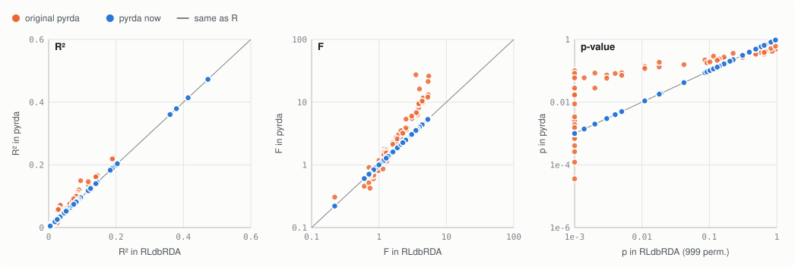
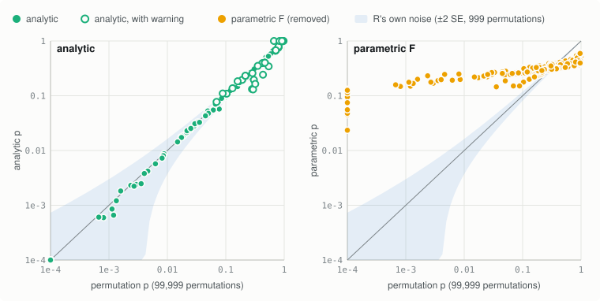
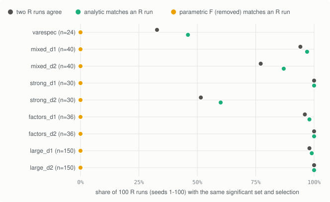
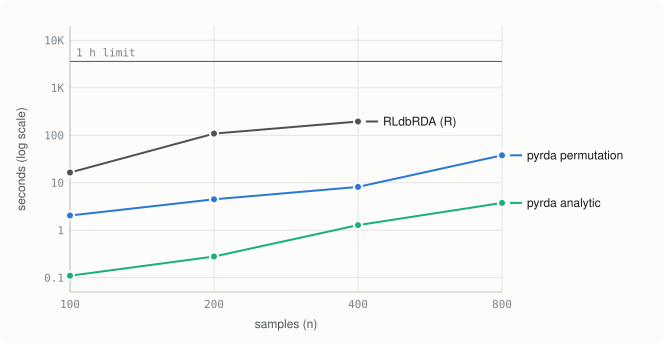

# pyrda vs RLdbRDA

*Validation report: pyrda 0.1.0, [RLdbRDA](https://github.com/raeslab/rldbrda) 0.1.3
(commit 98704d5), vegan 2.7.3, R 4.5.3.*

**Is pyrda a replacement for RLdbRDA?** pyrda is the Python port of the RaesLab
distance-based redundancy analysis workflow. This report compares it with the R package on
the package example and on synthetic communities: what differed, what was changed, how
close the two are now, and whether the permutation tests can be skipped.

## Verdict

| | Answer | Why |
|---|---|---|
| **Original port** | Not a replacement | It approximated `capscale` with 10 ordination axes and an averaged F, and replaced the permutation test by an F distribution. It failed in 68 of 86 synthetic runs, and where it did run, its selected variables matched R in 21% of cases. |
| **Now** | A drop-in replacement | Every statistic agrees with R to 3.9 × 10<sup>-14</sup>, and with `test="permutation"` and the same seed the p-values are identical. The only differences left are cases where R's own answer is decided by floating-point rounding or where R stops with an error. |
| **Without permutations** | Yes, now the default | The analytic test computes p-values from exact permutation moments: within R's own Monte Carlo noise for 99% of tests, and R's most frequent final result in 9 of 9 data sets. The parametric F-test of the original port was removed: it found no significant variable in any of them. |

- **143 / 184** synthetic runs identical to R, every statistic and p-value (same seed)
- **3.9 × 10<sup>-14</sup>** largest relative difference in any statistic (R², F, AIC, …)
- **29** runs where R drops a tied last variable by rounding; pyrda keeps it
- **21** vegan distance indices reproduced, same names as `vegdist`

## What was compared

The R reference is `RLdbRDA::rldbrda()`, which calls `vegan::vegdist`, `capscale`,
`anova.cca` (999 permutations per variable) and `ordiR2step` (9999 permutations per
step). Both packages ran in the project's dev container.

- **varespec / varechem**: 24 lichen pastures, 44 species, 14 soil variables, the package
  example (see [the README](../README.md#quick-start)).
- **Synthetic communities**: negative-binomial counts driven by hidden gradients, 6 to 150
  samples, with continuous, factor, logical, collinear and pure-noise metadata (7 designs).
- **The grid**: every design with 8 distance indices, `p_cutoff` 0.05 and 0.5, and two
  seeds: 184 runs, 9 minutes of R time.

"Same seed" means `set.seed(s)` before the call in R and `seed=s` in pyrda.

## What was different in the original port

| Part | RLdbRDA / vegan | Original pyrda | Consequence | Now |
|---|---|---|---|---|
| Distances | `vegdist()`, 22 indices, default `"bray"` | scipy `pdist`, default `"braycurtis"`; Jaccard is binary, Canberra unscaled, 16 vegan indices missing | Same name, different distance; most vegan indices unavailable | Port of `vegdist` (21 indices, same names) |
| Ordination | `capscale`: principal coordinates on every positive eigenvalue; R² = constrained / real inertia | First 10 axes only; R² = eigenvalue-weighted mean of per-axis R² | R² wrong, more so with more samples | `capscale` reproduced, including its rescaling of distances ≥ 4 |
| F statistic | (constrained / q) ÷ (residual / (n − q − 1)) | Eigenvalue-weighted mean of per-axis F | F up to 672% too large | vegan's pseudo-F |
| p-values | Permutation test, 999 permutations | F distribution applied to the averaged F | Far from R; on varespec no variable significant at 0.05 (R: 6) | Analytic test from exact permutation moments (default), or R's permutation test with R's own random stream |
| Factors | Treatment contrasts, k − 1 columns | k dummy columns, so adjusted R² and F used the wrong degrees of freedom; text columns of pandas ≥ 3 not recognised | Crash on text metadata in 25 of 86 runs | R's model matrix and its rule for aliased columns |
| Forward selection | `ordiR2step`: add the best adjusted R² while it improves and stays ≤ the R² of all variables; reports Df, AIC, F and p | Stop when the gain is < 0.001, no upper bound; Df = 1, AIC = 0, F = 0, p = 0.05 as placeholders | Different selected variables, meaningless step statistics | `ordiR2step` reproduced with real Df, AIC, F and p |
| <All variables> | Extra row with the R² of all significant variables; non-selected bars are drawn at that value | Missing | Plot bars of non-selected variables at the wrong height | Row added; plot data identical |
| Row order | Sort on r2, then on cumulative R² (stable) | Unstable sort and its own plot order | Different table and plot order | R's order |
| Randomness | R's Mersenne-Twister stream (no seed argument) | None needed | – | `set.seed`, `sample.int` and `permute::shuffleSet` reproduced bit for bit |



**Original vs new against RLdbRDA.** Each dot is one metadata variable of a synthetic data
set (Bray-Curtis, seed 1); on the line means equal to R. The original port only ran on
numeric metadata. The new version lies on the line for R², F and p-value: the p-values
are identical because both draw the same permutations.

<details>
<summary>Data: all variables (R, original pyrda, new pyrda)</summary>

| dataset | feature | R r2 | old r2 | new r2 | R F | old F | new F | R p | old p | new p |
|---|---|--:|--:|--:|--:|--:|--:|--:|--:|--:|
| collinear_d1_bray_0.05_1 | z | 0.1444 | 0.1663 | 0.1444 | 3.883 | 8.196 | 3.883 | 0.001 | 0.008799 | 0.001 |
| collinear_d1_bray_0.05_1 | x | 0.1208 | 0.1392 | 0.1208 | 3.16 | 5.835 | 3.16 | 0.001 | 0.02405 | 0.001 |
| collinear_d1_bray_0.05_1 | x_copy | 0.1208 | 0.1392 | 0.1208 | 3.16 | 5.835 | 3.16 | 0.001 | 0.02405 | 0.001 |
| collinear_d1_bray_0.05_1 | xz | 0.1184 | 0.136 | 0.1184 | 3.09 | 5.496 | 3.09 | 0.002 | 0.02806 | 0.002 |
| collinear_d1_bray_0.05_1 | w | 0.05606 | 0.06059 | 0.05606 | 1.366 | 1.612 | 1.366 | 0.184 | 0.2168 | 0.184 |
| collinear_d2_bray_0.05_1 | xz | 0.192 | 0.2223 | 0.192 | 5.467 | 26.06 | 5.467 | 0.001 | 3.595e-05 | 0.001 |
| collinear_d2_bray_0.05_1 | x | 0.14 | 0.1615 | 0.14 | 3.745 | 6.29 | 3.745 | 0.001 | 0.01964 | 0.001 |
| collinear_d2_bray_0.05_1 | z | 0.189 | 0.2186 | 0.189 | 5.36 | 21.29 | 5.36 | 0.001 | 0.0001219 | 0.001 |
| collinear_d2_bray_0.05_1 | x_copy | 0.14 | 0.1615 | 0.14 | 3.745 | 6.29 | 3.745 | 0.001 | 0.01964 | 0.001 |
| collinear_d2_bray_0.05_1 | w | 0.03737 | 0.03349 | 0.03737 | 0.8928 | 0.8128 | 0.8928 | 0.585 | 0.3766 | 0.585 |
| factors_d1_bray_0.05_1 | trt | 0.2026 |  | 0.2026 | 4.193 |  | 4.193 | 0.001 |  | 0.001 |
| factors_d1_bray_0.05_1 | batch | 0.1232 |  | 0.1232 | 1.499 |  | 1.499 | 0.019 |  | 0.019 |
| factors_d1_bray_0.05_1 | sex | 0.03752 |  | 0.03752 | 1.325 |  | 1.325 | 0.121 |  | 0.121 |
| factors_d1_bray_0.05_1 | age | 0.01749 | 0.01305 | 0.01749 | 0.6052 | 0.4561 | 0.6052 | 0.95 | 0.504 | 0.95 |
| factors_d2_bray_0.05_1 | trt | 0.1829 |  | 0.1829 | 3.693 |  | 3.693 | 0.001 |  | 0.001 |
| factors_d2_bray_0.05_1 | batch | 0.121 |  | 0.121 | 1.468 |  | 1.468 | 0.011 |  | 0.011 |
| factors_d2_bray_0.05_1 | sex | 0.0335 |  | 0.0335 | 1.178 |  | 1.178 | 0.18 |  | 0.18 |
| factors_d2_bray_0.05_1 | age | 0.028 | 0.0274 | 0.028 | 0.9795 | 1.007 | 0.9795 | 0.482 | 0.3227 | 0.482 |
| large_d1_bray_0.05_1 | m2 | 0.03016 | 0.068 | 0.03016 | 4.602 | 11.99 | 4.602 | 0.001 | 0.0006999 | 0.001 |
| large_d1_bray_0.05_1 | m1 | 0.02936 | 0.06632 | 0.02936 | 4.477 | 11.58 | 4.477 | 0.001 | 0.0008598 | 0.001 |
| large_d1_bray_0.05_1 | m0 | 0.02516 | 0.05507 | 0.02516 | 3.82 | 9.158 | 3.82 | 0.001 | 0.002921 | 0.001 |
| large_d1_bray_0.05_1 | m3 | 0.02571 | 0.05584 | 0.02571 | 3.905 | 9.443 | 3.905 | 0.001 | 0.002524 | 0.001 |
| large_d1_bray_0.05_1 | m11 | 0.01065 | 0.01479 | 0.01065 | 1.594 | 2.24 | 1.594 | 0.011 | 0.1366 | 0.011 |
| large_d1_bray_0.05_1 | grp | 0.02739 |  | 0.02739 | 1.021 |  | 1.021 | 0.405 |  | 0.405 |
| large_d1_bray_0.05_1 | m8 | 0.008751 | 0.009993 | 0.008751 | 1.307 | 1.51 | 1.307 | 0.086 | 0.2211 | 0.086 |
| large_d1_bray_0.05_1 | m9 | 0.00845 | 0.0119 | 0.00845 | 1.261 | 1.813 | 1.261 | 0.092 | 0.1802 | 0.092 |
| large_d1_bray_0.05_1 | m6 | 0.008134 | 0.0093 | 0.008134 | 1.214 | 1.396 | 1.214 | 0.129 | 0.2394 | 0.129 |
| large_d1_bray_0.05_1 | m7 | 0.008054 | 0.0106 | 0.008054 | 1.202 | 1.602 | 1.202 | 0.131 | 0.2076 | 0.131 |
| large_d1_bray_0.05_1 | m10 | 0.008044 | 0.01185 | 0.008044 | 1.2 | 1.785 | 1.2 | 0.159 | 0.1836 | 0.159 |
| large_d1_bray_0.05_1 | m4 | 0.007683 | 0.01059 | 0.007683 | 1.146 | 1.602 | 1.146 | 0.206 | 0.2076 | 0.206 |
| large_d1_bray_0.05_1 | m5 | 0.0066 | 0.005348 | 0.0066 | 0.9832 | 0.8081 | 0.9832 | 0.476 | 0.3701 | 0.476 |
| large_d2_bray_0.05_1 | m0 | 0.03517 | 0.07257 | 0.03517 | 5.394 | 13.08 | 5.394 | 0.001 | 0.0004088 | 0.001 |
| large_d2_bray_0.05_1 | m1 | 0.03458 | 0.07115 | 0.03458 | 5.302 | 12 | 5.302 | 0.001 | 0.0006959 | 0.001 |
| large_d2_bray_0.05_1 | m2 | 0.0295 | 0.06036 | 0.0295 | 4.499 | 9.994 | 4.499 | 0.001 | 0.001906 | 0.001 |
| large_d2_bray_0.05_1 | m3 | 0.02861 | 0.05741 | 0.02861 | 4.359 | 10.42 | 4.359 | 0.001 | 0.001532 | 0.001 |
| large_d2_bray_0.05_1 | m8 | 0.01204 | 0.01753 | 0.01204 | 1.803 | 2.738 | 1.803 | 0.001 | 0.1001 | 0.001 |
| large_d2_bray_0.05_1 | grp | 0.02171 |  | 0.02171 | 0.8046 |  | 0.8046 | 0.981 |  | 0.981 |
| large_d2_bray_0.05_1 | m5 | 0.0084 | 0.01137 | 0.0084 | 1.254 | 1.717 | 1.254 | 0.102 | 0.1921 | 0.102 |
| large_d2_bray_0.05_1 | m11 | 0.008099 | 0.01042 | 0.008099 | 1.208 | 1.623 | 1.208 | 0.169 | 0.2047 | 0.169 |
| large_d2_bray_0.05_1 | m10 | 0.008059 | 0.009661 | 0.008059 | 1.202 | 1.459 | 1.202 | 0.183 | 0.229 | 0.183 |
| large_d2_bray_0.05_1 | m9 | 0.008047 | 0.01043 | 0.008047 | 1.201 | 1.571 | 1.201 | 0.174 | 0.212 | 0.174 |
| large_d2_bray_0.05_1 | m4 | 0.007895 | 0.0096 | 0.007895 | 1.178 | 1.444 | 1.178 | 0.173 | 0.2314 | 0.173 |
| large_d2_bray_0.05_1 | m7 | 0.006056 | 0.006103 | 0.006056 | 0.9017 | 0.9134 | 0.9017 | 0.654 | 0.3408 | 0.654 |
| large_d2_bray_0.05_1 | m6 | 0.004746 | 0.003469 | 0.004746 | 0.7058 | 0.5177 | 0.7058 | 0.952 | 0.473 | 0.952 |
| mixed_d1_bray_0.05_1 | ph | 0.09501 | 0.1495 | 0.09501 | 3.989 | 16.2 | 3.989 | 0.001 | 0.0002623 | 0.001 |
| mixed_d1_bray_0.05_1 | site | 0.07639 |  | 0.07639 | 1.53 |  | 1.53 | 0.004 |  | 0.004 |
| mixed_d1_bray_0.05_1 | depth | 0.03312 | 0.02884 | 0.03312 | 1.302 | 1.144 | 1.302 | 0.115 | 0.2916 | 0.115 |
| mixed_d1_bray_0.05_1 | treated | 0.03215 |  | 0.03215 | 1.262 |  | 1.262 | 0.139 |  | 0.139 |
| mixed_d1_bray_0.05_1 | temp | 0.03085 | 0.0311 | 0.03085 | 1.21 | 1.233 | 1.21 | 0.165 | 0.2738 | 0.165 |
| mixed_d1_bray_0.05_1 | moist | 0.02923 | 0.02168 | 0.02923 | 1.144 | 0.8585 | 1.144 | 0.225 | 0.36 | 0.225 |
| mixed_d1_bray_0.05_1 | noise1 | 0.02129 | 0.01539 | 0.02129 | 0.8264 | 0.6002 | 0.8264 | 0.777 | 0.4433 | 0.777 |
| mixed_d1_bray_0.05_1 | noise2 | 0.02075 | 0.01668 | 0.02075 | 0.8054 | 0.6655 | 0.8054 | 0.802 | 0.4197 | 0.802 |
| mixed_d2_bray_0.05_1 | ph | 0.08962 | 0.1202 | 0.08962 | 3.741 | 6.116 | 3.741 | 0.001 | 0.01798 | 0.001 |
| mixed_d2_bray_0.05_1 | temp | 0.04923 | 0.06067 | 0.04923 | 1.968 | 3.093 | 1.968 | 0.005 | 0.08667 | 0.005 |
| mixed_d2_bray_0.05_1 | moist | 0.0459 | 0.05469 | 0.0459 | 1.828 | 2.36 | 1.828 | 0.018 | 0.1328 | 0.018 |
| mixed_d2_bray_0.05_1 | site | 0.05968 |  | 0.05968 | 1.174 |  | 1.174 | 0.202 |  | 0.202 |
| mixed_d2_bray_0.05_1 | noise1 | 0.03397 | 0.035 | 0.03397 | 1.336 | 1.44 | 1.336 | 0.14 | 0.2375 | 0.14 |
| mixed_d2_bray_0.05_1 | treated | 0.02667 |  | 0.02667 | 1.041 |  | 1.041 | 0.392 |  | 0.392 |
| mixed_d2_bray_0.05_1 | noise2 | 0.02148 | 0.01749 | 0.02148 | 0.8341 | 0.6879 | 0.8341 | 0.683 | 0.4121 | 0.683 |
| mixed_d2_bray_0.05_1 | depth | 0.01869 | 0.01708 | 0.01869 | 0.7238 | 0.6693 | 0.7238 | 0.855 | 0.4184 | 0.855 |
| strong_d1_bray_0.05_1 | v5 | 0.08604 | 0.1125 | 0.08604 | 2.636 | 3.857 | 2.636 | 0.001 | 0.05954 | 0.001 |
| strong_d1_bray_0.05_1 | v4 | 0.08321 | 0.1063 | 0.08321 | 2.541 | 3.585 | 2.541 | 0.001 | 0.06869 | 0.001 |
| strong_d1_bray_0.05_1 | v0 | 0.07242 | 0.094 | 0.07242 | 2.186 | 3.47 | 2.186 | 0.003 | 0.07302 | 0.003 |
| strong_d1_bray_0.05_1 | v1 | 0.07633 | 0.09787 | 0.07633 | 2.314 | 3.25 | 2.314 | 0.004 | 0.08221 | 0.004 |
| strong_d1_bray_0.05_1 | v2 | 0.07488 | 0.09616 | 0.07488 | 2.266 | 3.231 | 2.266 | 0.001 | 0.08305 | 0.001 |
| strong_d1_bray_0.05_1 | v3 | 0.06261 | 0.07555 | 0.06261 | 1.87 | 2.599 | 1.87 | 0.011 | 0.1181 | 0.011 |
| strong_d1_bray_0.05_1 | junk | 0.02554 | 0.01473 | 0.02554 | 0.7339 | 0.4245 | 0.7339 | 0.821 | 0.52 | 0.821 |
| strong_d2_bray_0.05_1 | v2 | 0.1175 | 0.1464 | 0.1175 | 3.727 | 6.451 | 3.727 | 0.001 | 0.01692 | 0.001 |
| strong_d2_bray_0.05_1 | v3 | 0.08252 | 0.102 | 0.08252 | 2.518 | 5.364 | 2.518 | 0.001 | 0.0281 | 0.001 |
| strong_d2_bray_0.05_1 | v4 | 0.08162 | 0.09971 | 0.08162 | 2.488 | 3.863 | 2.488 | 0.001 | 0.05934 | 0.001 |
| strong_d2_bray_0.05_1 | v0 | 0.07047 | 0.08606 | 0.07047 | 2.123 | 3.51 | 2.123 | 0.005 | 0.07147 | 0.005 |
| strong_d2_bray_0.05_1 | v1 | 0.05434 | 0.06142 | 0.05434 | 1.609 | 2.115 | 1.609 | 0.042 | 0.157 | 0.042 |
| strong_d2_bray_0.05_1 | v5 | 0.07436 | 0.09174 | 0.07436 | 2.249 | 3.195 | 2.249 | 0.002 | 0.0847 | 0.002 |
| strong_d2_bray_0.05_1 | junk | 0.04648 | 0.05 | 0.04648 | 1.365 | 1.592 | 1.365 | 0.131 | 0.2175 | 0.131 |
| tiny6_d1_bray_0.05_1 | x | 0.3605 | 0.3605 | 0.3605 | 2.255 | 2.532 | 2.255 | 0.01806 | 0.1868 | 0.01806 |
| tiny6_d1_bray_0.05_1 | y | 0.1999 | 0.1999 | 0.1999 | 0.9995 | 1.172 | 0.9995 | 0.4889 | 0.3399 | 0.4889 |
| tiny6_d2_bray_0.05_1 | x | 0.4728 | 0.4728 | 0.4728 | 3.587 | 6.802 | 3.587 | 0.001389 | 0.05954 | 0.001389 |
| tiny6_d2_bray_0.05_1 | y | 0.05214 | 0.05214 | 0.05214 | 0.22 | 0.3057 | 0.22 | 0.9569 | 0.6098 | 0.9569 |
| tiny7_d1_bray_0.05_1 | x | 0.4139 | 0.4139 | 0.4139 | 3.531 | 27.28 | 3.531 | 0.001 | 0.003402 | 0.001 |
| tiny7_d1_bray_0.05_1 | y | 0.1245 | 0.1245 | 0.1245 | 0.7113 | 0.9101 | 0.7113 | 0.649 | 0.3839 | 0.649 |
| tiny7_d2_bray_0.05_1 | x | 0.3792 | 0.3792 | 0.3792 | 3.054 | 5.993 | 3.054 | 0.003 | 0.05807 | 0.003 |
| tiny7_d2_bray_0.05_1 | y | 0.2038 | 0.2038 | 0.2038 | 1.28 | 1.555 | 1.28 | 0.311 | 0.2677 | 0.311 |
</details>

Across the 86 runs of the grid with seed 1, the original port could not run in most of
them: 32 used a vegan-only distance, 25 crashed on text metadata and 11 stopped with "No
significant features" where R found some. In the 29 runs that did finish, R² was off by
0.022 (median, up to 0.11), F by 113% (median, up to 672%) and p-values by 0.052. The set
of significant variables matched R in 45% of runs and the forward selection in 21%.

## How it was changed

pyrda now follows the R code path call by call, using vegan's source as the specification.
The public functions and their names stay the same; `method` now takes vegan names
(`"braycurtis"` still works), and `rldbrda()` gained `test` (`"analytic"` by default, or
`"permutation"`), `permutations`, `cumul_permutations` and `seed`. The parametric F-test is
gone.

- `distance.py`: `vegdist()`, the C kernels of `vegdist.c` and the `decostand` transforms
  they rely on.
- `core.py`: `capscale` (principal coordinates and redundancy analysis, aliasing like R's
  `qr()`), `anova.cca` and `anovaCCAlist` (vectorised permutation F tests), `RsquareAdj`,
  `extractAIC`, `ordiR2step`, `p.adjust`, and RLdbRDA's `combine_data` and
  `prepare_plot_data`.
- `rrandom.py`: R's `set.seed` scrambling, Mersenne-Twister, rejection sampling in
  `sample.int`, and `permute::shuffleSet` including its complete enumeration for 7 or
  fewer samples.
- `moments.py`: the permutation-free test described below.

The test suite compares pyrda with stored RLdbRDA output to a relative tolerance of
10<sup>-12</sup> ([`tests/test_r_reference.py`](../tests/test_r_reference.py), reference
files in [`tests/data/r_reference`](../tests/data/r_reference)).

## How close they are now

Of the 184 grid runs, 143 give the same table as R: same rows in the same order, every
statistic within 3.9 × 10<sup>-14</sup> and every p-value equal (largest difference
5.0 × 10<sup>-16</sup>, R's 15-digit printing). In 12 runs both stop with the same error,
"No significant features found". The remaining 29 runs are the rounding tie explained
below.

| scenario | R rounding tie | identical | same error |
|---|--:|--:|--:|
| collinear | 4 | 12 | 0 |
| factors | 1 | 15 | 0 |
| large | 0 | 6 | 2 |
| mixed | 4 | 56 | 4 |
| strong | 20 | 42 | 2 |
| tiny6 | 0 | 6 | 2 |
| tiny7 | 0 | 6 | 2 |

### Distances

All 21 implemented `vegdist` indices agree with R on three test matrices (counts with empty
species, sparse continuous data and strictly positive data). The largest relative
difference is at the level of R's printed precision. `robust.aitchison` is left out
because vegan imputes zeros with OptSpace matrix completion.

| vegdist index | test matrices | max relative difference |
|---|--:|--:|
| manhattan | 3 | 4.5 × 10<sup>-15</sup> |
| euclidean | 3 | 4.7 × 10<sup>-15</sup> |
| canberra | 3 | 5.6 × 10<sup>-16</sup> |
| bray | 3 | 6.7 × 10<sup>-16</sup> |
| kulczynski | 3 | 6.7 × 10<sup>-16</sup> |
| gower | 3 | 5.3 × 10<sup>-16</sup> |
| morisita | 3 | 6.7 × 10<sup>-16</sup> |
| horn | 3 | 6.7 × 10<sup>-16</sup> |
| mountford | 3 | 5.6 × 10<sup>-16</sup> |
| jaccard | 3 | 7.8 × 10<sup>-16</sup> |
| raup | 3 | 8.3 × 10<sup>-16</sup> |
| binomial | 3 | 4.8 × 10<sup>-15</sup> |
| chao | 3 | 7.8 × 10<sup>-16</sup> |
| altGower | 3 | 4.7 × 10<sup>-15</sup> |
| cao | 3 | 5.0 × 10<sup>-15</sup> |
| mahalanobis | 3 | 8.6 × 10<sup>-15</sup> |
| clark | 3 | 5.6 × 10<sup>-16</sup> |
| chisq | 3 | 4.8 × 10<sup>-15</sup> |
| chord | 3 | 4.7 × 10<sup>-15</sup> |
| hellinger | 3 | 4.9 × 10<sup>-15</sup> |
| aitchison | 1 | 2.4 × 10<sup>-15</sup> |

### The one systematic difference: ties at the end of forward selection

When the next variable completes the scope, its adjusted R² *is* the R² of
`<All variables>`. `ordiR2step` still compares the two with `<=`, on numbers fitted with
the columns in a different order, so the answer depends on rounding in the last bit. With
the same data and seed, R selects 5 or 6 variables depending only on the column order of
the metadata:

```text
v0,v1,v2,v3,v4,v5,junk                   -> 5 selected (v5,v4,v2,v1,v0)
v0,v3,v4,v2,v1,v5,junk                   -> 6 selected (v5,v4,v2,v1,v0,v3)
v5,v4,v3,junk,v2,v1,v0                   -> 5 selected (v5,v4,v2,v1,v0)
v1,v5,v3,v0,junk,v2,v4                   -> 6 selected (v5,v4,v2,v1,v0,v3)
v0,v1,v4,v3,v2,v5,junk                   -> 5 selected (v5,v4,v2,v1,v0)
v4,v5,v3,junk,v1,v0,v2                   -> 6 selected (v5,v4,v2,v1,v0,v3)
v5,v3,junk,v4,v0,v2,v1                   -> 5 selected (v5,v4,v2,v1,v0)
v0,v2,v4,junk,v3,v5,v1                   -> 5 selected (v5,v4,v2,v1,v0)
v4,v3,v2,v1,junk,v5,v0                   -> 6 selected (v5,v4,v2,v1,v0,v3)
v2,junk,v5,v1,v0,v3,v4                   -> 5 selected (v5,v4,v2,v1,v0)
junk,v4,v2,v1,v5,v3,v0                   -> 5 selected (v5,v4,v2,v1,v0)
v2,junk,v1,v4,v0,v3,v5                   -> 5 selected (v5,v4,v2,v1,v0)
v3,junk,v0,v5,v2,v4,v1                   -> 5 selected (v5,v4,v2,v1,v0)
v2,junk,v4,v0,v1,v3,v5                   -> 5 selected (v5,v4,v2,v1,v0)
v4,junk,v2,v3,v1,v0,v5                   -> 5 selected (v5,v4,v2,v1,v0)
v2,junk,v5,v0,v4,v3,v1                   -> 5 selected (v5,v4,v2,v1,v0)
```

pyrda evaluates the rule as written: equal is equal (within 10<sup>-10</sup>), so it adds
the variable, and its selection does not depend on column order. In the grid this changes
the last selected variable in 29 runs; every other value in those tables is identical. The
same tie occurs in vegan's own data: with only Al and P as metadata and `p_cutoff = 1`,
RLdbRDA selects P when the columns are ordered Al, P, but not when they are ordered P, Al.

### Where R stops with an error

- A constant metadata column makes R's `get_r2` fail (`number of columns of matrices must
  match`). pyrda reports R² = 0, warns, and continues.
- When no variable improves the adjusted R², R fails (`attempt to set 'rownames' on an
  object with no dimensions`) and leaves `meta` attached to the session. pyrda warns and
  returns an empty selection.
- R sorts the table on R² as text, so a variable with R² below about 10<sup>-4</sup>
  (printed as `1.5e-06`) is listed above larger ones. pyrda sorts numerically; for all
  other values the order is the same.

## P-values without permutations

The permutation tests are the slowest part of the workflow, and in R they also make the
result depend on the random seed. On varespec, 200 runs of RLdbRDA with seeds 1 to 200
give five different selections; the result that was shipped as the example output comes
up in 26% of them.

### How it works

Every test in the workflow rejects when a permutation of the samples gives a statistic
`tr(A·P·G·Pᵀ)` at least as large as the observed one, where `G` is the Gower matrix of the
principal coordinates and `A` the projection on the tested variables (for a
forward-selection step `A = (1+c)·H_new − H_old`). The mean, variance and skewness of that
statistic over all n! permutations can be computed exactly, without permuting (Kazi-Aoual
et al. 1995, *Comput. Stat. Data Anal.* 20:643). pyrda fits a Pearson type III curve to
those three moments and reports `(999·p + 1) / 1000`, the value R's 999-permutation test
gives on average, so the scale and the 0.001 floor match R.

### Accuracy



**Approximate p-values against permutation p-values** from 99,999 permutations, for 336
variables in 7 synthetic data sets of 12 to 300 samples (null, weak, skewed, rare binary
and factor variables; Bray-Curtis, Jaccard, Hellinger and Euclidean). Inside the band means
as close as a single R run is expected to be.

<details>
<summary>Data: all single-variable tests</summary>

| n | method | kind | df | permutation p | analytic p | parametric p | skew | warned |
|--:|---|---|--:|--:|--:|--:|--:|---|
| 12 | bray |  | 1 | 0.9385 | 0.9375 | 0.4435 | 0.3958 | False |
| 12 | bray | weak | 1 | 0.3243 | 0.3242 | 0.3184 | 0.5349 | False |
| 12 | bray | null_factor | 2 | 0.6825 | 0.6846 | 0.4467 | 0.7011 | False |
| 12 | bray | weak_factor | 1 | 0.2284 | 0.2291 | 0.3029 | 1.165 | False |
| 12 | bray | skewed | 1 | 0.6203 | 0.6253 | 0.3596 | 0.1649 | False |
| 12 | bray | unbalanced | 1 | 0.5004 | 0.4569 | 0.3358 | -0.02591 | False |
| 12 | bray |  | 1 | 0.3233 | 0.3302 | 0.3219 | 0.9006 | False |
| 12 | bray | weak | 1 | 0.06153 | 0.05785 | 0.2508 | 0.6549 | False |
| 12 | bray | null_factor | 2 | 0.375 | 0.3863 | 0.3912 | 0.5011 | False |
| 12 | bray | weak_factor | 1 | 0.1726 | 0.1777 | 0.2897 | 1.165 | False |
| 12 | bray | skewed | 1 | 0.8021 | 0.8009 | 0.4016 | 0.8298 | False |
| 12 | bray | unbalanced | 1 | 0.2408 | 0.215 | 0.2985 | 0.3766 | False |
| 12 | bray |  | 1 | 0.4926 | 0.494 | 0.3473 | 0.7035 | False |
| 12 | bray | weak | 1 | 0.2826 | 0.2889 | 0.314 | 0.8494 | False |
| 12 | bray | null_factor | 2 | 0.1285 | 0.1247 | 0.3285 | 0.7011 | False |
| 12 | bray | weak_factor | 1 | 0.5195 | 0.512 | 0.3562 | 1.195 | False |
| 12 | bray | skewed | 1 | 0.6688 | 0.6851 | 0.3693 | 0.2069 | False |
| 12 | bray | unbalanced | 1 | 0.9352 | 0.9312 | 0.4375 | 0.8435 | False |
| 12 | bray |  | 1 | 0.3259 | 0.3322 | 0.321 | 0.7348 | False |
| 12 | bray | weak | 1 | 0.8397 | 0.8454 | 0.4098 | 0.481 | False |
| 12 | bray | null_factor | 2 | 0.8381 | 0.8367 | 0.4788 | 0.7011 | False |
| 12 | bray | weak_factor | 1 | 0.2421 | 0.2499 | 0.3076 | 1.165 | False |
| 12 | bray | skewed | 1 | 0.7662 | 0.7589 | 0.3945 | 0.9555 | False |
| 12 | bray | unbalanced | 1 | 0.803 | 0.8056 | 0.399 | 0.3766 | False |
| 12 | bray |  | 1 | 0.8155 | 0.8071 | 0.4032 | 0.8392 | False |
| 12 | bray | weak | 1 | 0.4472 | 0.4516 | 0.3409 | 0.7247 | False |
| 12 | bray | null_factor | 2 | 0.9989 | 0.9992 | 0.6 | 0.5011 | False |
| 12 | bray | weak_factor | 1 | 0.7293 | 0.7178 | 0.3891 | 1.165 | False |
| 12 | bray | skewed | 1 | 0.2879 | 0.2902 | 0.3148 | 0.9436 | False |
| 12 | bray | unbalanced | 1 | 0.07719 | 0.0571 | 0.2556 | 0.3766 | False |
| 12 | bray |  | 1 | 0.2076 | 0.2075 | 0.297 | 0.7629 | False |
| 12 | bray | weak | 1 | 0.9992 | 0.9999 | 0.5213 | 0.864 | False |
| 12 | bray | null_factor | 2 | 0.8961 | 0.8881 | 0.4927 | 0.6422 | False |
| 12 | bray | weak_factor | 1 | 0.1636 | 0.1553 | 0.2834 | 1.063 | False |
| 12 | bray | skewed | 1 | 0.796 | 0.8134 | 0.4006 | 0.519 | False |
| 12 | bray | unbalanced | 1 | 0.9547 | 0.9474 | 0.45 | 0.3766 | False |
| 12 | bray |  | 1 | 0.6334 | 0.6289 | 0.3719 | 0.941 | False |
| 12 | bray | weak | 1 | 0.174 | 0.1779 | 0.2898 | 0.929 | False |
| 12 | bray | null_factor | 2 | 0.5646 | 0.5675 | 0.4256 | 0.7011 | False |
| 12 | bray | weak_factor | 1 | 0.227 | 0.2225 | 0.3009 | 1.063 | False |
| 12 | bray | skewed | 1 | 0.5872 | 0.5868 | 0.3638 | 0.8431 | False |
| 12 | bray | unbalanced | 1 | 0.2895 | 0.2969 | 0.3131 | 0.3766 | False |
| 12 | bray |  | 1 | 0.9468 | 0.9481 | 0.4444 | 0.8633 | False |
| 12 | bray | weak | 1 | 0.1811 | 0.1796 | 0.2928 | 0.4495 | False |
| 12 | bray | null_factor | 2 | 0.00462 | 0.004195 | 0.2457 | 0.5176 | False |
| 12 | bray | weak_factor | 1 | 0.2437 | 0.2466 | 0.3071 | 1.195 | False |
| 12 | bray | skewed | 1 | 0.8115 | 0.8088 | 0.4034 | 0.8368 | False |
| 12 | bray | unbalanced | 1 | 0.06133 | 0.05639 | 0.2553 | 0.3766 | False |
| 24 | bray |  | 1 | 0.2083 | 0.2091 | 0.2936 | 0.4528 | False |
| 24 | bray | weak | 1 | 0.5002 | 0.5016 | 0.3318 | 0.429 | False |
| 24 | bray | null_factor | 2 | 0.6823 | 0.681 | 0.4123 | 0.3884 | False |
| 24 | bray | weak_factor | 1 | 0.00159 | 0.001824 | 0.1996 | 0.5275 | False |
| 24 | bray | skewed | 1 | 0.1734 | 0.1739 | 0.2879 | 0.4985 | False |
| 24 | bray | unbalanced | 1 | 0.714 | 0.7173 | 0.3596 | 0.5993 | False |
| 24 | bray |  | 1 | 0.492 | 0.495 | 0.3313 | 0.4701 | False |
| 24 | bray | weak | 1 | 0.118 | 0.1165 | 0.2761 | 0.425 | False |
| 24 | bray | null_factor | 2 | 0.6611 | 0.6601 | 0.4094 | 0.3834 | False |
| 24 | bray | weak_factor | 1 | 0.5628 | 0.5653 | 0.3404 | 0.5259 | False |
| 24 | bray | skewed | 1 | 0.3214 | 0.3224 | 0.3115 | 0.5574 | False |
| 24 | bray | unbalanced | 1 | 0.04957 | 0.04895 | 0.2552 | 0.5993 | False |
| 24 | bray |  | 1 | 0.3635 | 0.3639 | 0.3153 | 0.4751 | False |
| 24 | bray | weak | 1 | 0.7249 | 0.7214 | 0.3587 | 0.2621 | False |
| 24 | bray | null_factor | 2 | 0.7004 | 0.7021 | 0.4154 | 0.3834 | False |
| 24 | bray | weak_factor | 1 | 0.4548 | 0.4577 | 0.3273 | 0.5297 | False |
| 24 | bray | skewed | 1 | 0.9364 | 0.9294 | 0.3963 | 0.5625 | False |
| 24 | bray | unbalanced | 1 | 0.2318 | 0.241 | 0.3006 | 0.6567 | False |
| 24 | bray |  | 1 | 0.9188 | 0.9185 | 0.4 | 0.3784 | False |
| 24 | bray | weak | 1 | 0.1269 | 0.1253 | 0.2779 | 0.4538 | False |
| 24 | bray | null_factor | 2 | 0.1027 | 0.1025 | 0.3228 | 0.3903 | False |
| 24 | bray | weak_factor | 1 | 0.09793 | 0.09414 | 0.2698 | 0.5259 | False |
| 24 | bray | skewed | 1 | 0.8649 | 0.8636 | 0.3849 | 0.4998 | False |
| 24 | bray | unbalanced | 1 | 0.3279 | 0.3231 | 0.3113 | 0.5993 | False |
| 24 | bray |  | 1 | 0.6843 | 0.6848 | 0.3553 | 0.4805 | False |
| 24 | bray | weak | 1 | 0.51 | 0.511 | 0.3331 | 0.4452 | False |
| 24 | bray | null_factor | 2 | 0.6506 | 0.6516 | 0.4082 | 0.3847 | False |
| 24 | bray | weak_factor | 1 | 0.474 | 0.4799 | 0.33 | 0.5263 | False |
| 24 | bray | skewed | 1 | 0.08645 | 0.08407 | 0.269 | 0.449 | False |
| 24 | bray | unbalanced | 1 | 0.4068 | 0.3971 | 0.3212 | 0.6567 | False |
| 24 | bray |  | 1 | 0.8879 | 0.8856 | 0.3903 | 0.4572 | False |
| 24 | bray | weak | 1 | 0.1245 | 0.1232 | 0.2775 | 0.4693 | False |
| 24 | bray | null_factor | 2 | 0.6508 | 0.6515 | 0.4081 | 0.3844 | False |
| 24 | bray | weak_factor | 1 | 0.1343 | 0.1321 | 0.2791 | 0.5263 | False |
| 24 | bray | skewed | 1 | 0.02989 | 0.02883 | 0.2445 | 0.4778 | False |
| 24 | bray | unbalanced | 1 | 0.2673 | 0.2712 | 0.3038 | 0.5714 | False |
| 24 | bray |  | 1 | 0.0494 | 0.04877 | 0.2551 | 0.4584 | False |
| 24 | bray | weak | 1 | 0.44 | 0.4423 | 0.3246 | 0.4133 | False |
| 24 | bray | null_factor | 2 | 0.2092 | 0.2067 | 0.3457 | 0.3834 | False |
| 24 | bray | weak_factor | 1 | 0.9095 | 0.9079 | 0.3962 | 0.5263 | False |
| 24 | bray | skewed | 1 | 0.7836 | 0.7831 | 0.3689 | 0.5145 | False |
| 24 | bray | unbalanced | 1 | 0.7423 | 0.7398 | 0.3633 | 0.5448 | False |
| 24 | bray |  | 1 | 0.4583 | 0.4626 | 0.3266 | 0.3633 | False |
| 24 | bray | weak | 1 | 0.1646 | 0.1634 | 0.2856 | 0.4744 | False |
| 24 | bray | null_factor | 2 | 0.1322 | 0.1319 | 0.3303 | 0.3847 | False |
| 24 | bray | weak_factor | 1 | 0.456 | 0.4558 | 0.3271 | 0.5297 | False |
| 24 | bray | skewed | 1 | 0.9714 | 0.9706 | 0.4172 | 0.5697 | False |
| 24 | bray | unbalanced | 1 | 0.0817 | 0.0826 | 0.2676 | 0.5993 | False |
| 40 | jaccard |  | 1 | 0.3269 | 0.3283 | 0.3131 | 0.6407 | False |
| 40 | jaccard | weak | 1 | 0.4204 | 0.4198 | 0.3207 | 0.6383 | False |
| 40 | jaccard | null_factor | 2 | 0.8327 | 0.831 | 0.4107 | 0.509 | False |
| 40 | jaccard | weak_factor | 1 | 0.7767 | 0.7743 | 0.3492 | 0.7108 | False |
| 40 | jaccard | skewed | 1 | 0.5714 | 0.5664 | 0.332 | 0.6779 | False |
| 40 | jaccard | unbalanced | 1 | 0.5907 | 0.5865 | 0.3337 | 0.7343 | False |
| 40 | jaccard |  | 1 | 0.02859 | 0.02797 | 0.2643 | 0.6667 | False |
| 40 | jaccard | weak | 1 | 0.5299 | 0.5324 | 0.3295 | 0.6697 | False |
| 40 | jaccard | null_factor | 2 | 0.4486 | 0.4501 | 0.3763 | 0.5093 | False |
| 40 | jaccard | weak_factor | 1 | 0.9941 | 0.9959 | 0.3918 | 0.7134 | False |
| 40 | jaccard | skewed | 1 | 0.4596 | 0.4636 | 0.3237 | 0.5611 | False |
| 40 | jaccard | unbalanced | 1 | 0.09986 | 0.1047 | 0.2877 | 0.7428 | False |
| 40 | jaccard |  | 1 | 0.6208 | 0.6213 | 0.3363 | 0.6677 | False |
| 40 | jaccard | weak | 1 | 0.1759 | 0.1759 | 0.2974 | 0.6418 | False |
| 40 | jaccard | null_factor | 2 | 0.3606 | 0.3595 | 0.3683 | 0.5093 | False |
| 40 | jaccard | weak_factor | 1 | 0.00237 | 0.002312 | 0.2312 | 0.711 | False |
| 40 | jaccard | skewed | 1 | 0.05128 | 0.04879 | 0.2803 | 0.4835 | False |
| 40 | jaccard | unbalanced | 1 | 0.8097 | 0.806 | 0.3514 | 0.7343 | False |
| 40 | jaccard |  | 1 | 0.3812 | 0.3817 | 0.3177 | 0.6549 | False |
| 40 | jaccard | weak | 1 | 0.09962 | 0.1006 | 0.2858 | 0.681 | False |
| 40 | jaccard | null_factor | 2 | 0.5154 | 0.517 | 0.3818 | 0.5096 | False |
| 40 | jaccard | weak_factor | 1 | 0.7442 | 0.7417 | 0.3463 | 0.711 | False |
| 40 | jaccard | skewed | 1 | 0.8004 | 0.7946 | 0.3504 | 0.6611 | False |
| 40 | jaccard | unbalanced | 1 | 0.9439 | 0.9458 | 0.3696 | 0.7285 | False |
| 40 | jaccard |  | 1 | 0.7068 | 0.7063 | 0.3429 | 0.6324 | False |
| 40 | jaccard | weak | 1 | 0.6037 | 0.6015 | 0.3347 | 0.6562 | False |
| 40 | jaccard | null_factor | 2 | 0.1839 | 0.1847 | 0.3496 | 0.509 | False |
| 40 | jaccard | weak_factor | 1 | 0.03298 | 0.03301 | 0.2662 | 0.7108 | False |
| 40 | jaccard | skewed | 1 | 0.5319 | 0.5348 | 0.3291 | 0.6253 | False |
| 40 | jaccard | unbalanced | 1 | 0.3521 | 0.3529 | 0.3156 | 0.717 | False |
| 40 | jaccard |  | 1 | 0.4737 | 0.4744 | 0.3249 | 0.6238 | False |
| 40 | jaccard | weak | 1 | 0.1933 | 0.1966 | 0.3001 | 0.6293 | False |
| 40 | jaccard | null_factor | 2 | 0.8575 | 0.857 | 0.4139 | 0.5097 | False |
| 40 | jaccard | weak_factor | 1 | 0.0295 | 0.03083 | 0.2652 | 0.7116 | False |
| 40 | jaccard | skewed | 1 | 0.4123 | 0.4157 | 0.3208 | 0.682 | False |
| 40 | jaccard | unbalanced | 1 | 0.3211 | 0.3279 | 0.3141 | 0.7564 | False |
| 40 | jaccard |  | 1 | 0.8074 | 0.8056 | 0.352 | 0.6456 | False |
| 40 | jaccard | weak | 1 | 0.1927 | 0.1975 | 0.3001 | 0.6495 | False |
| 40 | jaccard | null_factor | 2 | 0.1962 | 0.1978 | 0.3513 | 0.5093 | False |
| 40 | jaccard | weak_factor | 1 | 0.2399 | 0.2407 | 0.3049 | 0.711 | False |
| 40 | jaccard | skewed | 1 | 0.6082 | 0.6095 | 0.3341 | 0.5418 | False |
| 40 | jaccard | unbalanced | 1 | 0.5306 | 0.5505 | 0.3307 | 0.7799 | False |
| 40 | jaccard |  | 1 | 0.04495 | 0.04486 | 0.2721 | 0.6336 | False |
| 40 | jaccard | weak | 1 | 0.9004 | 0.8991 | 0.363 | 0.648 | False |
| 40 | jaccard | null_factor | 2 | 0.3925 | 0.3937 | 0.3714 | 0.51 | False |
| 40 | jaccard | weak_factor | 1 | 0.9821 | 0.9841 | 0.3827 | 0.711 | False |
| 40 | jaccard | skewed | 1 | 0.1494 | 0.1468 | 0.296 | 0.5715 | False |
| 40 | jaccard | unbalanced | 1 | 0.5196 | 0.517 | 0.3286 | 0.7428 | False |
| 60 | bray |  | 1 | 0.3573 | 0.3566 | 0.3099 | 0.9672 | False |
| 60 | bray | weak | 1 | 0.8303 | 0.821 | 0.3772 | 0.9691 | False |
| 60 | bray | null_factor | 2 | 0.333 | 0.3327 | 0.3552 | 0.7139 | False |
| 60 | bray | weak_factor | 1 | 0.00081 | 0.0005942 | 0.1477 | 1.014 | False |
| 60 | bray | skewed | 1 | 0.2303 | 0.2337 | 0.2906 | 0.9785 | False |
| 60 | bray | unbalanced | 1 | 0.1852 | 0.1911 | 0.2813 | 1.032 | False |
| 60 | bray |  | 1 | 0.8452 | 0.8375 | 0.3802 | 0.9589 | False |
| 60 | bray | weak | 1 | 0.1905 | 0.1975 | 0.2821 | 0.9679 | False |
| 60 | bray | null_factor | 2 | 0.7486 | 0.7423 | 0.4186 | 0.7142 | False |
| 60 | bray | weak_factor | 1 | 0.04723 | 0.05045 | 0.2355 | 1.014 | False |
| 60 | bray | skewed | 1 | 0.1129 | 0.1166 | 0.2636 | 0.9518 | False |
| 60 | bray | unbalanced | 1 | 0.3957 | 0.3909 | 0.3158 | 1.041 | False |
| 60 | bray |  | 1 | 0.7937 | 0.7809 | 0.3704 | 0.9683 | False |
| 60 | bray | weak | 1 | 0.01911 | 0.01876 | 0.2108 | 0.9813 | False |
| 60 | bray | null_factor | 2 | 0.6345 | 0.6269 | 0.4002 | 0.7136 | False |
| 60 | bray | weak_factor | 1 | 0.00295 | 0.002399 | 0.1692 | 1.015 | False |
| 60 | bray | skewed | 1 | 0.232 | 0.2369 | 0.2919 | 0.9377 | False |
| 60 | bray | unbalanced | 1 | 0.716 | 0.7005 | 0.3581 | 1.041 | False |
| 60 | bray |  | 1 | 0.5733 | 0.563 | 0.339 | 0.9656 | False |
| 60 | bray | weak | 1 | 0.529 | 0.5195 | 0.333 | 0.9622 | False |
| 60 | bray | null_factor | 2 | 0.7322 | 0.7267 | 0.416 | 0.7134 | False |
| 60 | bray | weak_factor | 1 | 0.2443 | 0.2496 | 0.2925 | 1.014 | False |
| 60 | bray | skewed | 1 | 0.4965 | 0.4901 | 0.3291 | 0.997 | False |
| 60 | bray | unbalanced | 1 | 0.01826 | 0.01817 | 0.2102 | 1.048 | False |
| 60 | bray |  | 1 | 0.121 | 0.1266 | 0.2651 | 0.9704 | False |
| 60 | bray | weak | 1 | 0.01715 | 0.01757 | 0.2092 | 0.9843 | False |
| 60 | bray | null_factor | 2 | 0.8325 | 0.8268 | 0.4342 | 0.7143 | False |
| 60 | bray | weak_factor | 1 | 0.0012 | 0.0006597 | 0.1492 | 1.014 | False |
| 60 | bray | skewed | 1 | 0.06641 | 0.06949 | 0.2459 | 0.9978 | False |
| 60 | bray | unbalanced | 1 | 0.3046 | 0.3051 | 0.3025 | 1.036 | False |
| 60 | bray |  | 1 | 0.722 | 0.7086 | 0.3593 | 0.9615 | False |
| 60 | bray | weak | 1 | 0.06736 | 0.07178 | 0.2465 | 0.9668 | False |
| 60 | bray | null_factor | 2 | 0.918 | 0.9175 | 0.4569 | 0.713 | False |
| 60 | bray | weak_factor | 1 | 0.4064 | 0.4035 | 0.3173 | 1.014 | False |
| 60 | bray | skewed | 1 | 0.987 | 0.9948 | 0.4335 | 0.9467 | False |
| 60 | bray | unbalanced | 1 | 0.7648 | 0.7511 | 0.3652 | 1.048 | False |
| 60 | bray |  | 1 | 0.8947 | 0.8947 | 0.392 | 0.9665 | False |
| 60 | bray | weak | 1 | 0.7081 | 0.6918 | 0.357 | 0.9785 | False |
| 60 | bray | null_factor | 2 | 0.1071 | 0.1098 | 0.3057 | 0.7147 | False |
| 60 | bray | weak_factor | 1 | 0.07084 | 0.07531 | 0.2475 | 1.014 | False |
| 60 | bray | skewed | 1 | 0.5611 | 0.5362 | 0.3343 | 1.067 | False |
| 60 | bray | unbalanced | 1 | 0.08571 | 0.08954 | 0.254 | 1.048 | False |
| 60 | bray |  | 1 | 0.8007 | 0.7913 | 0.3722 | 0.982 | False |
| 60 | bray | weak | 1 | 0.0492 | 0.05273 | 0.2374 | 0.9671 | False |
| 60 | bray | null_factor | 2 | 0.2136 | 0.2164 | 0.3335 | 0.7136 | False |
| 60 | bray | weak_factor | 1 | 0.4627 | 0.4544 | 0.3246 | 1.014 | False |
| 60 | bray | skewed | 1 | 0.704 | 0.6913 | 0.356 | 0.9574 | False |
| 60 | bray | unbalanced | 1 | 0.3292 | 0.3282 | 0.3063 | 1.041 | False |
| 100 | hellinger |  | 1 | 0.9092 | 0.908 | 0.3888 | 0.9087 | False |
| 100 | hellinger | weak | 1 | 0.1014 | 0.1051 | 0.2608 | 0.9064 | False |
| 100 | hellinger | null_factor | 2 | 0.8841 | 0.882 | 0.4393 | 0.6491 | False |
| 100 | hellinger | weak_factor | 1 | 0.2353 | 0.2385 | 0.2902 | 0.9185 | False |
| 100 | hellinger | skewed | 1 | 0.4568 | 0.4546 | 0.3222 | 0.9625 | False |
| 100 | hellinger | unbalanced | 1 | 0.3428 | 0.343 | 0.3071 | 0.9663 | False |
| 100 | hellinger |  | 1 | 0.0246 | 0.02401 | 0.2217 | 0.9094 | False |
| 100 | hellinger | weak | 1 | 0.6194 | 0.6093 | 0.3416 | 0.9102 | False |
| 100 | hellinger | null_factor | 2 | 0.944 | 0.9442 | 0.4583 | 0.6481 | False |
| 100 | hellinger | weak_factor | 1 | 0.00269 | 0.002227 | 0.177 | 0.9189 | False |
| 100 | hellinger | skewed | 1 | 0.9021 | 0.9011 | 0.3856 | 0.9862 | False |
| 100 | hellinger | unbalanced | 1 | 0.4662 | 0.4634 | 0.3232 | 0.9491 | False |
| 100 | hellinger |  | 1 | 0.813 | 0.8078 | 0.3694 | 0.9074 | False |
| 100 | hellinger | weak | 1 | 0.00067 | 0.0006063 | 0.1587 | 0.9092 | False |
| 100 | hellinger | null_factor | 2 | 0.1479 | 0.1494 | 0.3186 | 0.6483 | False |
| 100 | hellinger | weak_factor | 1 | 0.2374 | 0.2397 | 0.2904 | 0.917 | False |
| 100 | hellinger | skewed | 1 | 0.08026 | 0.08513 | 0.2546 | 1.003 | False |
| 100 | hellinger | unbalanced | 1 | 0.01746 | 0.0173 | 0.2134 | 1.008 | False |
| 100 | hellinger |  | 1 | 0.8264 | 0.8223 | 0.3718 | 0.9095 | False |
| 100 | hellinger | weak | 1 | 0.7375 | 0.7273 | 0.3573 | 0.9092 | False |
| 100 | hellinger | null_factor | 2 | 0.1947 | 0.1977 | 0.3295 | 0.6482 | False |
| 100 | hellinger | weak_factor | 1 | 0.00877 | 0.008703 | 0.2005 | 0.9189 | False |
| 100 | hellinger | skewed | 1 | 0.00625 | 0.005709 | 0.1921 | 1.04 | False |
| 100 | hellinger | unbalanced | 1 | 0.2922 | 0.2935 | 0.2995 | 0.9566 | False |
| 100 | hellinger |  | 1 | 0.4301 | 0.427 | 0.3181 | 0.9098 | False |
| 100 | hellinger | weak | 1 | 0.9442 | 0.9456 | 0.3994 | 0.9093 | False |
| 100 | hellinger | null_factor | 2 | 0.2417 | 0.242 | 0.3381 | 0.6481 | False |
| 100 | hellinger | weak_factor | 1 | 0.2617 | 0.2649 | 0.2946 | 0.9171 | False |
| 100 | hellinger | skewed | 1 | 0.3053 | 0.3086 | 0.304 | 1.173 | False |
| 100 | hellinger | unbalanced | 1 | 0.1081 | 0.1124 | 0.263 | 0.9526 | False |
| 100 | hellinger |  | 1 | 0.3962 | 0.3943 | 0.3137 | 0.9064 | False |
| 100 | hellinger | weak | 1 | 0.1074 | 0.1111 | 0.2626 | 0.908 | False |
| 100 | hellinger | null_factor | 2 | 0.373 | 0.3737 | 0.3597 | 0.6506 | False |
| 100 | hellinger | weak_factor | 1 | 0.00134 | 0.001209 | 0.1678 | 0.917 | False |
| 100 | hellinger | skewed | 1 | 0.09578 | 0.1026 | 0.2607 | 1.031 | False |
| 100 | hellinger | unbalanced | 1 | 0.3943 | 0.3924 | 0.3141 | 0.9791 | False |
| 100 | hellinger |  | 1 | 0.3763 | 0.3757 | 0.3111 | 0.9036 | False |
| 100 | hellinger | weak | 1 | 0.1089 | 0.1112 | 0.2626 | 0.9052 | False |
| 100 | hellinger | null_factor | 2 | 0.7601 | 0.7583 | 0.4151 | 0.6484 | False |
| 100 | hellinger | weak_factor | 1 | 0.07516 | 0.07787 | 0.2516 | 0.9174 | False |
| 100 | hellinger | skewed | 1 | 0.06114 | 0.05486 | 0.2444 | 1.016 | False |
| 100 | hellinger | unbalanced | 1 | 0.1282 | 0.1318 | 0.2682 | 0.9491 | False |
| 100 | hellinger |  | 1 | 0.5222 | 0.517 | 0.3298 | 0.9081 | False |
| 100 | hellinger | weak | 1 | 0.6109 | 0.607 | 0.3413 | 0.9083 | False |
| 100 | hellinger | null_factor | 2 | 0.8835 | 0.8822 | 0.4394 | 0.6491 | False |
| 100 | hellinger | weak_factor | 1 | 0.02141 | 0.02137 | 0.219 | 0.917 | False |
| 100 | hellinger | skewed | 1 | 0.5638 | 0.5528 | 0.3349 | 0.9865 | False |
| 100 | hellinger | unbalanced | 1 | 0.00853 | 0.008032 | 0.1982 | 0.9722 | False |
| 150 | euclidean |  | 1 | 0.7105 | 0.6674 | 0.4432 | 2.233 | True |
| 150 | euclidean | weak | 1 | 0.7921 | 0.7581 | 0.4748 | 2.379 | True |
| 150 | euclidean | null_factor | 2 | 0.7036 | 0.6984 | 0.4646 | 1.179 | False |
| 150 | euclidean | weak_factor | 1 | 0.325 | 0.3363 | 0.2921 | 1.203 | False |
| 150 | euclidean | skewed | 1 | 0.2813 | 0.1322 | 0.3882 | 9.572 | True |
| 150 | euclidean | unbalanced | 1 | 0.4633 | 0.3988 | 0.3815 | 3.261 | True |
| 150 | euclidean |  | 1 | 0.8021 | 0.7738 | 0.4698 | 2.064 | True |
| 150 | euclidean | weak | 1 | 0.1035 | 0.1089 | 0.1772 | 2.496 | True |
| 150 | euclidean | null_factor | 2 | 0.5164 | 0.52 | 0.4002 | 1.054 | False |
| 150 | euclidean | weak_factor | 1 | 0.1848 | 0.1797 | 0.2351 | 1.203 | False |
| 150 | euclidean | skewed | 1 | 0.5423 | 0.344 | 0.4322 | 5.592 | True |
| 150 | euclidean | unbalanced | 1 | 0.7812 | 0.7451 | 0.4594 | 2.612 | True |
| 150 | euclidean |  | 1 | 0.7077 | 0.6639 | 0.4437 | 2.319 | True |
| 150 | euclidean | weak | 1 | 0.2862 | 0.2585 | 0.2929 | 3.044 | True |
| 150 | euclidean | null_factor | 2 | 0.05036 | 0.04756 | 0.187 | 1.054 | False |
| 150 | euclidean | weak_factor | 1 | 0.3495 | 0.3614 | 0.2996 | 1.165 | False |
| 150 | euclidean | skewed | 1 | 0.4328 | 0.2421 | 0.4093 | 6.574 | True |
| 150 | euclidean | unbalanced | 1 | 0.9746 | 1 | 0.5757 | 2.66 | True |
| 150 | euclidean |  | 1 | 0.7981 | 0.7908 | 0.4746 | 2.566 | True |
| 150 | euclidean | weak | 1 | 0.1911 | 0.1955 | 0.24 | 2.191 | True |
| 150 | euclidean | null_factor | 2 | 0.2418 | 0.2475 | 0.3043 | 1.078 | False |
| 150 | euclidean | weak_factor | 1 | 0.4808 | 0.5026 | 0.3481 | 1.333 | False |
| 150 | euclidean | skewed | 1 | 0.6677 | 1 | 0.4604 | 7.33 | True |
| 150 | euclidean | unbalanced | 1 | 0.9444 | 1 | 0.5736 | 3.261 | True |
| 150 | euclidean |  | 1 | 0.1303 | 0.137 | 0.2001 | 2.16 | True |
| 150 | euclidean | weak | 1 | 0.7172 | 0.6757 | 0.4446 | 2.359 | True |
| 150 | euclidean | null_factor | 2 | 0.4011 | 0.4051 | 0.3635 | 1.125 | False |
| 150 | euclidean | weak_factor | 1 | 0.2106 | 0.2032 | 0.2448 | 1.238 | False |
| 150 | euclidean | skewed | 1 | 0.831 | 1 | 0.5374 | 6.063 | True |
| 150 | euclidean | unbalanced | 1 | 0.08862 | 0.11 | 0.1509 | 3.76 | True |
| 150 | euclidean |  | 1 | 0.2173 | 0.2301 | 0.2562 | 2.159 | True |
| 150 | euclidean | weak | 1 | 0.9169 | 1 | 0.5301 | 2.683 | True |
| 150 | euclidean | null_factor | 2 | 0.9241 | 0.9177 | 0.5602 | 1.083 | False |
| 150 | euclidean | weak_factor | 1 | 0.03548 | 0.03259 | 0.1454 | 1.188 | False |
| 150 | euclidean | skewed | 1 | 0.3027 | 0.1955 | 0.3792 | 6.756 | True |
| 150 | euclidean | unbalanced | 1 | 0.1593 | 0.1839 | 0.2362 | 3.261 | True |
| 150 | euclidean |  | 1 | 0.8612 | 0.8417 | 0.4919 | 1.982 | False |
| 150 | euclidean | weak | 1 | 0.4239 | 0.3944 | 0.35 | 2.644 | True |
| 150 | euclidean | null_factor | 2 | 0.9622 | 0.9576 | 0.5922 | 1.045 | False |
| 150 | euclidean | weak_factor | 1 | 0.1597 | 0.1471 | 0.2211 | 1.147 | False |
| 150 | euclidean | skewed | 1 | 0.2934 | 0.1305 | 0.3562 | 9.185 | True |
| 150 | euclidean | unbalanced | 1 | 0.466 | 0.4002 | 0.3859 | 3.319 | True |
| 150 | euclidean |  | 1 | 0.06949 | 0.07715 | 0.1509 | 2.885 | True |
| 150 | euclidean | weak | 1 | 0.3521 | 0.3511 | 0.322 | 2.371 | True |
| 150 | euclidean | null_factor | 2 | 0.2366 | 0.239 | 0.3007 | 1.174 | False |
| 150 | euclidean | weak_factor | 1 | 0.6301 | 0.6572 | 0.3937 | 1.148 | False |
| 150 | euclidean | skewed | 1 | 0.3192 | 0.1643 | 0.3713 | 7.918 | True |
| 150 | euclidean | unbalanced | 1 | 0.2167 | 0.2323 | 0.272 | 2.999 | True |
| 300 | bray |  | 1 | 0.1852 | 0.1916 | 0.2846 | 0.9466 | False |
| 300 | bray | weak | 1 | 0.5497 | 0.5389 | 0.3295 | 0.9472 | False |
| 300 | bray | null_factor | 2 | 0.1049 | 0.1072 | 0.3121 | 0.6745 | False |
| 300 | bray | weak_factor | 1 | 1e-05 | 5.255e-13 | 0.04503 | 0.954 | False |
| 300 | bray | skewed | 1 | 0.00113 | 0.0008522 | 0.1759 | 0.9606 | False |
| 300 | bray | unbalanced | 1 | 0.3471 | 0.3443 | 0.3071 | 0.9624 | False |
| 300 | bray |  | 1 | 0.7861 | 0.7758 | 0.3565 | 0.9465 | False |
| 300 | bray | weak | 1 | 1e-05 | 1.24e-12 | 0.04771 | 0.9484 | False |
| 300 | bray | null_factor | 2 | 0.9054 | 0.9037 | 0.432 | 0.6745 | False |
| 300 | bray | weak_factor | 1 | 1e-05 | 1.175e-07 | 0.09473 | 0.9541 | False |
| 300 | bray | skewed | 1 | 0.07012 | 0.07256 | 0.2605 | 0.7964 | False |
| 300 | bray | unbalanced | 1 | 0.02173 | 0.02298 | 0.2293 | 0.9638 | False |
| 300 | bray |  | 1 | 0.5947 | 0.5819 | 0.3342 | 0.9481 | False |
| 300 | bray | weak | 1 | 0.01493 | 0.01436 | 0.22 | 0.9471 | False |
| 300 | bray | null_factor | 2 | 0.1712 | 0.1734 | 0.3277 | 0.6745 | False |
| 300 | bray | weak_factor | 1 | 0.00356 | 0.002477 | 0.1898 | 0.954 | False |
| 300 | bray | skewed | 1 | 0.04501 | 0.04297 | 0.2551 | 0.6524 | False |
| 300 | bray | unbalanced | 1 | 0.2134 | 0.2169 | 0.2891 | 0.9659 | False |
| 300 | bray |  | 1 | 0.3019 | 0.3054 | 0.302 | 0.9482 | False |
| 300 | bray | weak | 1 | 0.06622 | 0.07033 | 0.2552 | 0.9477 | False |
| 300 | bray | null_factor | 2 | 0.4443 | 0.4392 | 0.3672 | 0.6745 | False |
| 300 | bray | weak_factor | 1 | 1e-05 | 1.804e-11 | 0.05536 | 0.954 | False |
| 300 | bray | skewed | 1 | 0.02519 | 0.02528 | 0.2445 | 0.6727 | False |
| 300 | bray | unbalanced | 1 | 0.4245 | 0.4175 | 0.316 | 0.9627 | False |
| 300 | bray |  | 1 | 0.3985 | 0.3941 | 0.3131 | 0.9469 | False |
| 300 | bray | weak | 1 | 1e-05 | 3.957e-18 | 0.02346 | 0.9481 | False |
| 300 | bray | null_factor | 2 | 0.00812 | 0.007244 | 0.2494 | 0.6746 | False |
| 300 | bray | weak_factor | 1 | 2e-05 | 4.366e-06 | 0.12 | 0.9541 | False |
| 300 | bray | skewed | 1 | 0.1197 | 0.1265 | 0.2724 | 0.959 | False |
| 300 | bray | unbalanced | 1 | 0.3317 | 0.332 | 0.3056 | 0.968 | False |
| 300 | bray |  | 1 | 0.7642 | 0.7498 | 0.3533 | 0.9474 | False |
| 300 | bray | weak | 1 | 1e-05 | 2.319e-09 | 0.07459 | 0.9479 | False |
| 300 | bray | null_factor | 2 | 0.805 | 0.7994 | 0.4128 | 0.6745 | False |
| 300 | bray | weak_factor | 1 | 1e-05 | 3.011e-06 | 0.1171 | 0.954 | False |
| 300 | bray | skewed | 1 | 5e-05 | 8.886e-06 | 0.1266 | 0.9603 | False |
| 300 | bray | unbalanced | 1 | 0.08479 | 0.08973 | 0.2617 | 0.9634 | False |
| 300 | bray |  | 1 | 0.3782 | 0.3753 | 0.3109 | 0.9468 | False |
| 300 | bray | weak | 1 | 2e-05 | 4.543e-06 | 0.1208 | 0.947 | False |
| 300 | bray | null_factor | 2 | 0.5862 | 0.581 | 0.3842 | 0.6744 | False |
| 300 | bray | weak_factor | 1 | 4e-05 | 1.64e-05 | 0.1313 | 0.954 | False |
| 300 | bray | skewed | 1 | 0.3145 | 0.3175 | 0.304 | 0.9753 | False |
| 300 | bray | unbalanced | 1 | 0.9663 | 0.9756 | 0.395 | 0.9616 | False |
| 300 | bray |  | 1 | 0.12 | 0.1247 | 0.271 | 0.9475 | False |
| 300 | bray | weak | 1 | 0.00403 | 0.003806 | 0.1967 | 0.9483 | False |
| 300 | bray | null_factor | 2 | 0.3059 | 0.3071 | 0.3498 | 0.6745 | False |
| 300 | bray | weak_factor | 1 | 2e-05 | 1.745e-06 | 0.1129 | 0.954 | False |
| 300 | bray | skewed | 1 | 4e-05 | 7.413e-06 | 0.1256 | 0.9622 | False |
| 300 | bray | unbalanced | 1 | 0.5372 | 0.5256 | 0.3281 | 0.9654 | False |
</details>

| p-value from | median \|Δp\| | 95th pct \|Δp\| | within R's noise | same call at 0.05 |
|---|--:|--:|--:|--:|
| analytic, all tests | 0.0029 | 0.034 | 93.2% | 98.8% |
| analytic, tests without warning | 0.0026 | 0.013 | 99.3% | 98.7% |
| analytic, tests with warning | 0.0361 | 0.194 | 32.3% | 100.0% |
| one R run (999 permutations) | 0.0068 | 0.026 | 94.6% | 99.1% |
| parametric F | 0.1756 | 0.498 | 7.1% | 86.3% |

The analytic test is closer to the permutation p-value than a single R run is (median
error 0.0026 vs 0.0068 for tests without a warning). The parametric F-test, used by the
original port, is off by 0.176 in the median and far too conservative: only 7% of its
p-values fall within R's noise. It has been removed. For the nested tests of the forward
selection, 93% of analytic p-values fall within R's noise (parametric: 7%).

**When it warns.** The approximation needs a reasonably smooth permutation distribution.
When a few samples dominate the variation, for example Euclidean distance on raw counts,
that distribution becomes lumpy and the Pearson curve can be off by 0.1 or more. pyrda
computes the exact skewness for every test anyway; above 2 it still returns the analytic
value but warns, naming the variables, so you can recheck them with `test="permutation"`.
It never switches method on its own. Here 9% of tests were flagged: 65% of those with
Euclidean distance on counts and none for the other indices.

### Does it change the conclusions?



**Same significant variables and same selection as R.** R was run with seeds 1 to 100
(pyrda's permutation mode with the same seeds is identical to R). The grey dot is the
chance that two R runs agree with each other; the green dot is the share of R runs that
the analytic test matches.

<details>
<summary>Data: decision agreement per dataset</summary>

| dataset | n | n vars | R distinct outcomes | R modal share | R self agreement | analytic agrees with R | analytic is modal | parametric agrees with R | analytic warned |
|---|--:|--:|--:|--:|--:|--:|---|--:|---|
| varespec | 24 | 14 | 4 | 46% | 33% | 46% | True | 0% | 'N', 'P' |
| mixed_d1 | 40 | 8 | 2 | 97% | 94% | 97% | True | 0% |  |
| mixed_d2 | 40 | 8 | 2 | 87% | 77% | 87% | True | 0% |  |
| strong_d1 | 30 | 7 | 1 | 100% | 100% | 100% | True | 0% |  |
| strong_d2 | 30 | 7 | 2 | 60% | 52% | 60% | True | 0% |  |
| factors_d1 | 36 | 4 | 2 | 98% | 96% | 98% | True | 0% |  |
| factors_d2 | 36 | 4 | 1 | 100% | 100% | 100% | True | 0% |  |
| large_d1 | 150 | 13 | 2 | 99% | 98% | 99% | True | 0% |  |
| large_d2 | 150 | 13 | 1 | 100% | 100% | 100% | True | 0% |  |
</details>

The analytic test returns R's most frequent outcome in 9 of 9 data sets, so it agrees with
a random R run more often (mean 87%) than two R runs agree with each other (mean 83%). The
parametric F-test matched R in 0% of runs: it found no significant variable in any data
set.

### Speed



**Run time of the full workflow** for 500 species and 20 metadata variables, by number of
samples (log scales), one run at a time on a 16-core machine with R's default BLAS. Each
run had a one-hour limit. Where runs finished, all three selected the same variables.

| samples | RLdbRDA (R) | pyrda permutation | pyrda analytic | memory, R | memory, permutation | memory, analytic |
|--:|---|--:|--:|---|---|---|
| 100 | 16 s | 2.0 s | 0.1 s | 298 MB | 260 MB | 162 MB |
| 200 | 108 s | 4.5 s | 0.3 s | 326 MB | 383 MB | 165 MB |
| 400 | 3 min | 8.2 s | 1.3 s | 408 MB | 425 MB | 175 MB |
| 800 | not run | 38 s | 3.8 s |  | 674 MB | 209 MB |

The number of species only affects the distance matrix; the number of metadata variables
multiplies the per-variable tests and the forward-selection steps.

## Problems found in RLdbRDA

The comparison turned up five issues in the R package:

- The forward selection depends on the column order of the metadata (the rounding tie
  above; root cause in `vegan::ordiR2step`).
- A constant metadata column crashes `rldbrda()`.
- When no variable is selected, `rldbrda()` fails and leaves `meta` attached.
- Statistics are returned as text and sorted as text.
- Results depend on the unseeded random stream, and there is no seed argument.

## Reproduce

```python
import pandas as pd
from pyrda import rldbrda

spec = pd.read_csv("docs/data/varespec.tsv", sep="\t", index_col=0)
chem = pd.read_csv("docs/data/varechem.tsv", sep="\t", index_col=0)

rldbrda(spec, chem)  # analytic p-values (default)
rldbrda(spec, chem, test="permutation", seed=1)  # == set.seed(1); rldbrda(...) in R
```

```bash
# exact comparison with stored RLdbRDA output
uv run pytest tests/test_r_reference.py
```
